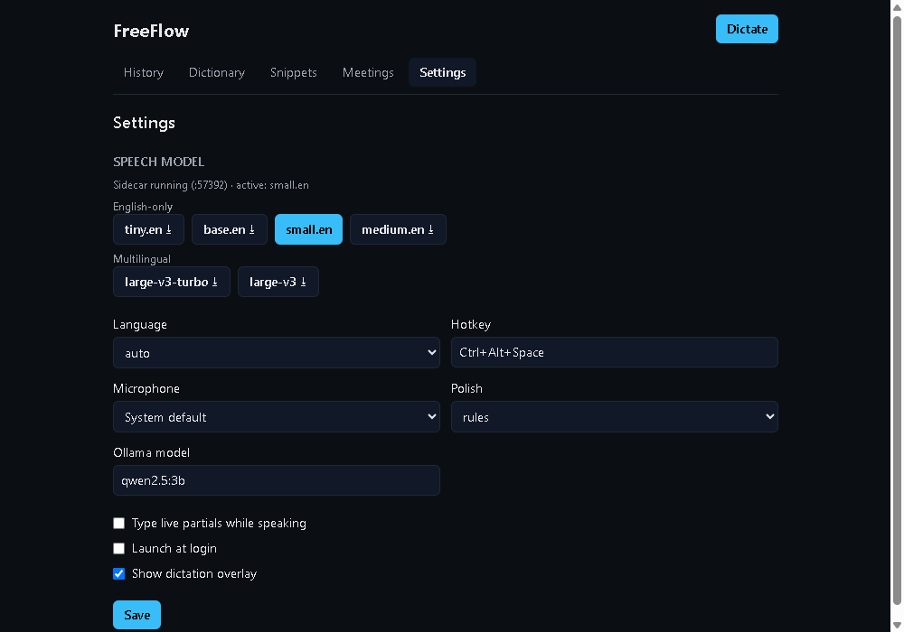
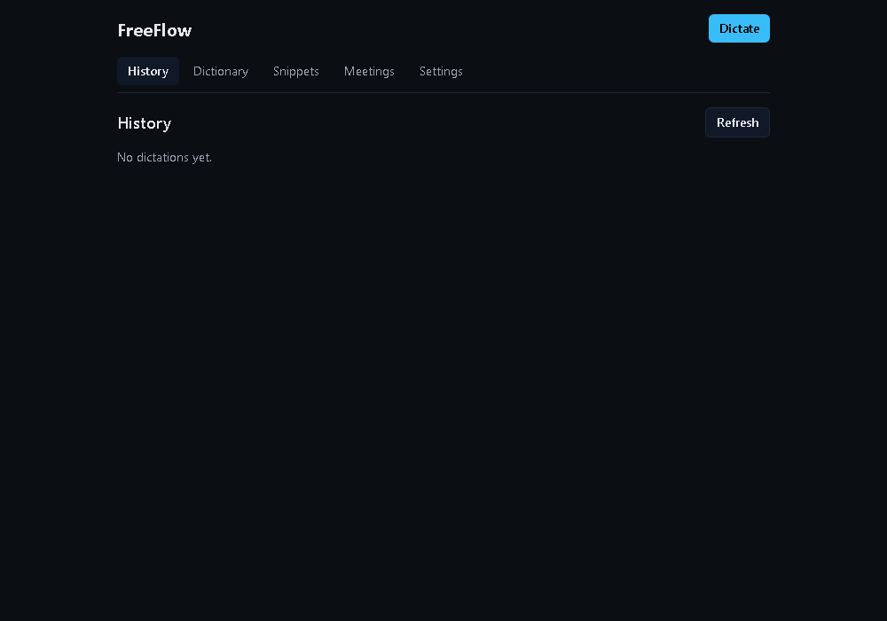
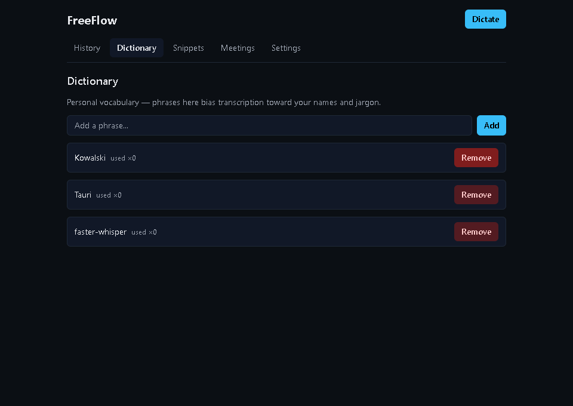
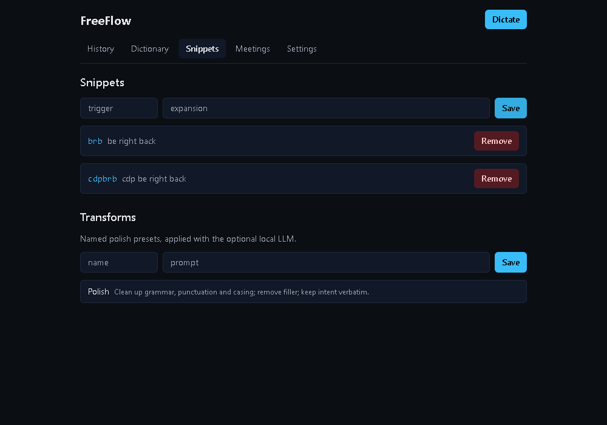
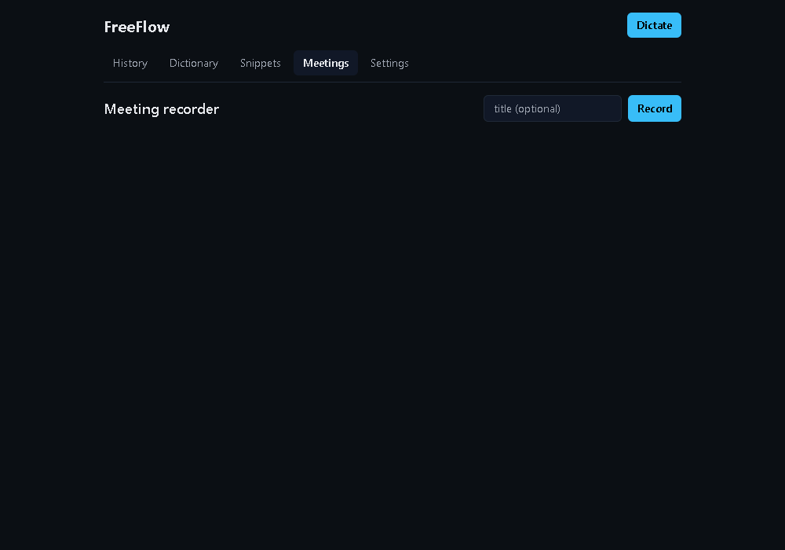

<p align="center">
  
</p>

<h1 align="center">FreeFlow</h1>

<p align="center">
  Open-source local voice typing.<br>
  Dictation, polish, and meeting notes — entirely on-device.
</p>

<p align="center">
  <a href="#quick-start">Quick Start</a> ·
  <a href="DESIGN.md">Documentation</a> ·
  <a href="https://github.com/Dvorinka/freeflow/releases">Releases</a> ·
  <a href="#contributing">Contributing</a>
</p>

<p align="center">
  <a href="https://github.com/Dvorinka/freeflow/actions/workflows/ci.yml"></a>
  <a href="https://github.com/Dvorinka/freeflow/releases"></a>
  <a href="LICENSE"></a>
</p>

## What is FreeFlow?

FreeFlow is a self-contained desktop app for voice typing: hold a hotkey,
speak, release — the words land in whatever field has focus, cleaned up
and formatted for the app you're in. A meeting recorder captures mic plus
system audio into transcribed notes. Everything runs locally: speech
recognition is faster-whisper on your CPU, polishing is deterministic
rules (or your own local Ollama model), storage is SQLite. No account, no
cloud STT, no telemetry.

> Your voice never leaves the machine.

<p align="center">
  
</p>

<table>
  <tr>
    <td></td>
    <td></td>
  </tr>
  <tr>
    <td></td>
    <td></td>
  </tr>
</table>

## Features

- **Push-to-talk dictation** - global hotkey (default `Ctrl+Alt+Space`) with a status overlay; live phase feedback from listening to typing.
- **Local speech recognition** - faster-whisper sidecar over loopback HTTP. Model switcher in Settings: English-only (`tiny.en` … `medium.en`) vs multilingual (`large-v3-turbo`, `large-v3`). Models download once from Hugging Face into the app data dir.
- **Polish that respects context** - rule-based cleanup by default (fillers, casing, punctuation); optional local-LLM pass via Ollama with per-app style prompts (code, email, chat, document, casual).
- **App-aware formatting** - the focused process maps to a category, so code stays verbatim while email gets courteous prose.
- **Personal dictionary** - your names and jargon bias the decoder through the transcription prompt, with used/seen frequencies learned from what you dictate.
- **History** - every dictation keeps raw text, cleaned text, app, language, and model; re-type any entry with one click.
- **Snippets & transforms** - trigger expansions plus named polish presets for the local-LLM pass.
- **Meeting recorder** - mic plus WASAPI system-audio loopback mixed to WAV, chunked transcription, optional local-LLM notes and action items. No diarization by design.
- **Tray-first** - lives in the tray, autostart optional, single instance.

## Architecture

```
Hotkey ──▶ Tauri app (Rust) ──HTTP/127.0.0.1──▶ faster-whisper sidecar
   │         │ mic (cpal) → 16 kHz mono PCM       (frozen Python exe)
   │         │ transcribe → cleanup → inject
   │         │ SendInput typing / clipboard+paste
   │         └── SQLite: history, dictionary, snippets, transforms, meetings
   └── optional: Ollama :11434 for the polish pass
```

Dictation pipeline: hotkey down opens the mic → hotkey up ships PCM to
`/transcribe` (dictionary-biased prompt) → rules cleanup or Ollama polish
→ typed into the previously focused window → history row saved. Details in
[DESIGN.md](DESIGN.md).

## Quick Start

Prerequisites: Rust toolchain + MSVC build tools (Windows) or system
WebKit deps (Linux, see [ci.yml](.github/workflows/ci.yml)), Node 20+,
Python 3.13 with a venv for the sidecar.

```bash
git clone https://github.com/Dvorinka/freeflow.git && cd freeflow

# whisper sidecar: dev run + freeze
cd sidecar
.\.venv\Scripts\python.exe -m pip install -r requirements.txt
.\.venv\Scripts\python.exe freeflow_whisper.py   # prints PORT <n>
.\build.ps1   # frozen exe -> dist/whisper-sidecar/ (+ dev copy)
cd ..

# frontend
npm install
npm run dev      # Vite on :1420 for `tauri dev`

# app (from repo root so the dev sidecar resolves)
cd src-tauri && cargo run
```

Or grab a packaged build from
[Releases](https://github.com/Dvorinka/freeflow/releases) (Windows setup,
Linux AppImage/deb) — the frozen sidecar ships inside.

```bash
cargo test    # backend incl. live sidecar + loopback capture tests
npm run lint  # strict tsc
node scripts/cdp-smoke.mjs   # UI smoke vs the running app (needs WebView2 :9223)
```

## Configuration

Settings live in the app (persisted to SQLite): speech model, language,
hotkey, microphone, polish mode (`rules` / `none` / `ollama`), Ollama
model, autostart, overlay. The sidecar takes `FREEFLOW_MODEL` for its
preload default. No config files, no env secrets — there is nothing to
leak because nothing leaves the box.

## Ecosystem

- **[src-tauri/src/](src-tauri/src/)** - Rust core: `audio`, `inject`, `foreapp`, `stt`, `cleanup`, `store`, `commands`, `meetings`, `loopback`, `tray`.
- **[sidecar/](sidecar/)** - `freeflow_whisper.py` (`/health`, `/models`, `/models/select`, `/transcribe`) + `build.ps1` freeze script.
- **[src/](src/)** - React 18 + Vite + strict TS + Tailwind UI: overlay, history, dictionary, snippets, meetings, settings.
- **[scripts/](scripts/)** - `ipc-parity.py` (frontend/backend contract check), `cdp-smoke.mjs` (UI smoke), `shots.mjs` (README screenshots).

## Documentation

- [DESIGN.md](DESIGN.md) - recon summary, pipeline, data model, out of scope
- [sidecar/](sidecar/) - sidecar API (`build.ps1` to freeze)
- [assets/brand/](assets/brand/) - logo kit

## Contributing

See [CONTRIBUTING.md](CONTRIBUTING.md) for the workflow: feature branches,
PR-first (never push to `main`), and the pre-push gate — `cargo build`
warning-free, `cargo test`, `tsc`, UI smoke green.

## Security

Voice audio is processed in memory and only persisted as meeting WAVs you
record. No network listeners outside loopback, no analytics, no update
phone-home. See [SECURITY.md](SECURITY.md) for reporting vulnerabilities.

## License

[MIT](LICENSE)
